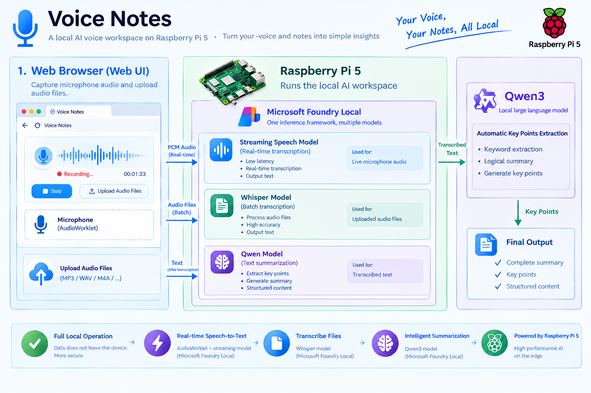

# Voice Notes: Flask + Foundry Local Transcription

[简体中文](README.zh-CN.md)



A standalone, local-only web application for live speech transcription and batch audio transcription. It builds on the existing Foundry Local samples without changing them. The interface, app messages, export headings, and generated summaries are in English. Transcripts retain the language recognized by the selected speech model.

## Features

- **Live transcription:** browser microphone → AudioWorklet resampling → 16 kHz mono PCM16LE → Flask → Foundry Local. The UI waits 100 ms between completed status requests (300 ms after an error), without overlapping requests, and displays confirmed text alongside lighter interim text. Revised interim hypotheses replace previous ones instead of being duplicated. Faster polling reduces display delay, not model inference time.
- **Live model selection:** `nemotron-3.5-asr-streaming-0.6b` for multilingual speech or `nemotron-speech-streaming-en-0.6b` for English. Stop the current session and wait for its summary before switching models.
- **Batch file transcription:** choose `whisper-small` or `whisper-tiny`, with up to 10 files and a maximum total request size of 100 MiB. Files are processed sequentially; a failed file does not discard successful results.
- **Session times and playback:** store only the job's start and end times, not segment or word timestamps. Play back a completed live recording in the browser.
- **Local exports:** save captured audio as PCM WAV and download WAV, TXT, and JSON artifacts. Batch jobs provide TXT and JSON, not a new recording.
- **Microphone diagnostics:** select a recording device and monitor its input level. Browser echo cancellation, noise suppression, and automatic gain control are disabled to preserve the original signal. Five seconds without sound triggers a warning; stalled capture stops and saves the session. Empty and completely silent recordings include diagnostic warnings.
- **Automatic English summaries:** after live ASR stops and unloads, `qwen3-0.6b` extracts topics, key points, decisions, and action items. Long transcripts use hierarchical summaries rather than silent truncation. Summary failures do not delete audio or text.

## Requirements

- Python 3.11 or later.
- Foundry Local SDK 2.1 or later, within the dependency bounds in [requirements.txt](requirements.txt).
- Models and execution providers available for your operating system, architecture, and hardware.
- A recent Chrome, Edge, or Firefox with `getUserMedia`, Web Audio, and AudioWorklet support.

Model choices in the UI are supported aliases, **not a guarantee that your hardware catalog contains them**. Availability and memory use must be checked on the target device, especially Raspberry Pi / ARM64. Load failures show the actual error; the app does not substitute fabricated transcripts.

Microphone access requires a secure context: use **localhost**, **127.0.0.1**, or HTTPS. A plain HTTP LAN address cannot capture audio. The microphone belongs to the device running the browser, not necessarily the server.

## Install and run

From the workspace root, using your selected Python environment:

```bash
python -m pip install -r flask-audio-transcription/requirements.txt
python flask-audio-transcription/src/app.py
```

Open **http://127.0.0.1:5000**.

Use the **same interpreter for installation and execution**. The workspace's Flask task follows the interpreter selected in VS Code. If you change environments, install the dependencies in the new environment and restart the server.

The requirements automatically select `foundry-local-sdk` on Linux/macOS or `foundry-local-sdk-winml` on Windows. These are PyPI packages: if Conda cannot find them, invoke pip through the Python interpreter in that Conda environment. The Python import name is `foundry_local_sdk`.

The backend preserves the Linux SDK 2.1.0 `CI=1` workaround for the native telemetry/curl segmentation fault. It is version-scoped; see [upstream PR #1153](https://github.com/microsoft/foundry-local/pull/1153).

First use may take time while execution providers and the selected model download. The UI reports preparation, download, and loading progress. Stopping during preparation takes effect when the current native operation returns; the app does not forcibly interrupt the download thread.

### Configuration

| Environment variable | Default | Purpose |
| --- | --- | --- |
| `PORT` | `5000` | Local server port |
| `TRANSCRIPTION_DATA_DIR` | The application's local data directory | Recording and transcript storage |

Run directly with the debug reloader disabled. Do not configure multiple WSGI workers: jobs and the single inference slot are process-local.

## Usage

### Live transcription

1. Select **Live transcription**, a recording device, a model, and the speech language.
2. Click **Start live transcription** and grant microphone access.
3. Wait for the model to become ready, then speak. Check that the microphone level changes.
4. Watch confirmed and interim text appear. Lighter text may be revised by the model.
5. Click **Stop & summarize**. Remaining audio is processed, the recording is saved, and an English summary is generated.
6. Review the transcript and start/end times, play the recording, or download the artifacts.

Speech language defaults to **Auto-detect**. The English-only Nemotron model accepts English or auto-detection; select the multilingual model for other languages. Changing the interface to English does not force speech recognition to English.

### Audio files

1. Select **Audio files**, a Whisper model, and the speech language.
2. Choose or drop up to 10 files.
3. Click **Start batch transcription**.
4. Review each file's result or error, then download TXT or JSON.

Accepted extensions: **WAV and MP3 only**, with **16 kHz mono** audio. Use **16-bit PCM** encoding for WAV; MP3 is compressed audio, not a PCM file format. Prepare files with these settings before uploading; the app does not automatically convert or resample uploaded files. The file picker, drag-and-drop selection, and server reject other extensions; sample rate and encoding guidance is not a metadata validation check. Corrupt or unsupported files report an error. File jobs do not automatically generate summaries.

## Troubleshooting

### Missing SDK

If the app reports `No module named 'foundry_local_sdk'`, its error includes the actual server interpreter and the dependency installation command. Install into that environment and restart Flask; do not change the SDK import name.

### No transcript or silent recording

Start with the microphone input level. A loaded model does not mean the browser is receiving usable audio.

- **Level stays at zero:** stop, choose the correct microphone, and retry. After permission is granted, the device list shows actual names. Check system input mute, capture volume, USB connections, and browser permissions.
- **Complete-silence warning:** the audio received by the app contains only zeros. Fix the input and record again; missing speech cannot be recovered from a silent recording.
- **Level changes and WAV contains sound, but no transcript:** check the model's supported language and the actual inference error in the terminal.
- **WAV has nonzero audio but playback is silent:** check the output device. On Linux, a system with only Dummy Output needs a working speaker/headphone output; this is separate from microphone capture.

The JSON `audio_peak` field is the maximum absolute PCM16 sample value. A value of zero means complete silence.

## Architecture

- [src/app.py](src/app.py): Flask application factory, validation, same-origin request protection, job APIs, and artifact downloads.
- [src/foundry_backend.py](src/foundry_backend.py): SDK initialization, model lifecycle, native live audio sessions, Whisper file adapter, and hierarchical Qwen summaries.
- [src/service.py](src/service.py): single-job locking, workers, ordered/idempotent PCM ingestion, WAV writing, transcript assembly, and idle cleanup.
- [src/templates/index.html](src/templates/index.html) and [src/static/app.js](src/static/app.js): responsive English interface without external CDNs.
- [src/static/pcm-worklet.js](src/static/pcm-worklet.js): continuous resampling and browser PCM capture.
- [tests/test_app.py](tests/test_app.py), [tests/test_foundry_backend.py](tests/test_foundry_backend.py), and [tests/test_pcm_worklet.py](tests/test_pcm_worklet.py): application, native-buffer, and resampling tests.

Live streaming uses `AudioSession`, `ItemQueue`, and `SpeechSegmentItem`. Only text and confirmation state are copied; segment timestamps are not stored. Interim text is replaced, final tokens are concatenated without inserting spaces, and terminal `SpeechResultItem` or `TextItem` aggregate output replaces the full transcript instead of duplicating it.

Summaries use a fresh native `ChatSession` for each hierarchical chunk and pass OpenAI JSON with `chat_template_kwargs.enable_thinking=false`. The Qwen template must disable thinking explicitly: `/no_think` in the prompt alone can return only `reasoning_content` with an empty final answer. Internal reasoning is never displayed as a summary. File transcription still uses the compatibility client deprecated in SDK 2.1 and will need migration when that client is removed.

### Native audio buffer lifetime

In SDK 2.1, native inference may still reference Python audio memory after a `BytesItem` handle is transferred to `ItemQueue`. The app retains input items until the native request, session, and queue close, then releases the backing buffers. Neither `push()` completion nor queue length proves that a buffer has been consumed.

Premature release can produce sparse or corrupted recognition even when the saved WAV is correct. The 60-minute limit corresponds to approximately 115.2 MB of retained PCM, plus object and model overhead. Terminal diagnostics report chunk/byte counts, duration, stream events, text length, and peak level, not transcript contents.

### Timestamps and exports

JSON `started_at` and `ended_at` are timezone-aware ISO 8601 UTC values. The English UI displays them in the browser's local timezone. Live start time is recorded on the first audio chunk; end time is recorded when input stops, excluding summary generation. A session with no audio has no start time. Batch jobs record the batch processing boundaries.

Exports do not contain `segments` or `timestamp_source`. Existing recordings and exports are not rewritten or translated by this UI update. Newly exported TXT headings and app-generated warnings are English.

## API

| Method | Endpoint | Purpose |
| --- | --- | --- |
| GET | `/api/config` | Candidate models and recording duration limit |
| POST | `/api/live` | JSON `model` and `language`; create a live job |
| POST | `/api/jobs/<id>/audio` | PCM bytes with `Content-Type: application/octet-stream` and increasing `X-Audio-Sequence` |
| POST | `/api/jobs/<id>/stop` | Finish input, drain inference, save audio, and summarize |
| POST | `/api/files` | Multipart `files`, `model`, and `language` |
| GET | `/api/jobs/<id>` | Status, interim/final text, start/end times, file results, and summary |
| GET | `/api/jobs/<id>/artifacts/<name>` | Allowed artifacts; add `?download=1` to force a download |

Every POST requires the current page's `X-App-Token`, supplied automatically by the frontend. Cross-site requests are rejected and Host is validated. CORS is not enabled.

Live states: `loading → recording → stopping → summarizing → saving → done`. File states: `loading → transcribing → saving → done`. Failures use `error`.

## Storage and limits

- Each job has a UUID-named local directory. WAV/TXT/JSON remain on disk; uploaded source files are deleted after processing.
- Only one inference job runs at a time, preventing ASR and Qwen from occupying memory simultaneously. A competing request receives HTTP 409.
- Maximum live recording: 3,600 seconds. No audio for 60 seconds triggers automatic stop and attempted save/summary.
- The browser stops capture if the upload queue falls about 10 seconds behind. Retrying an already accepted audio sequence does not duplicate WAV samples.
- Refreshing or leaving requests a best-effort stop; idle cleanup handles unexpected disconnection. The browser can restore recent results while the server process remains alive.
- A server restart cannot restore an active native session. Completed artifact URLs remain accessible. Forced termination or power loss may leave an unfinished WAV header.
- At most 50 recent jobs are kept in memory. Disk data is not deleted automatically; clean up sensitive recordings regularly. Partial failures still attempt to save received audio and text.

## Safety and privacy

This is a **single-user local sample, not a public service**. It binds to `127.0.0.1`, disables debugging, limits uploads, generates storage paths server-side, restricts artifact names, and renders model text using `textContent`. The request token protects against cross-site writes; it is not user authentication.

Audio and transcripts are processed locally. First use downloads models, and the underlying SDK may send telemetry depending on its version and configuration. Do not expose the app publicly without HTTPS, authentication, access control, rate limiting, durable job storage, retention policies, and auditing. Browser permission does not replace participants' consent to recording.

## Tests

From the workspace root:

```bash
python -m pip install -r flask-audio-transcription/requirements-dev.txt
python -m pytest flask-audio-transcription/tests -q
```

Coverage includes request protection, English UI/messages and summary prompts, model validation, batch failure isolation, PCM ordering/idempotency, WAV integrity, summary fallback, idle/duration limits, live text revisions and aggregate deduplication, and session times without segment timestamps.

Most tests use fake inference backends. With the standard SDK installed, native queue tests check PCM buffer integrity; with Chromium installed, tests check JavaScript resampling. These tests **do not establish real-model accuracy, catalog availability, or microphone permissions**. Validate those manually on the target device.