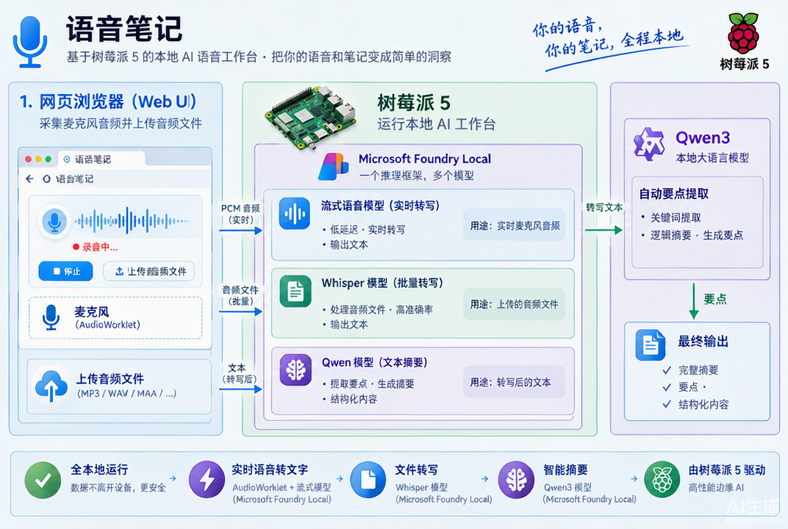

# 声笺：Flask + Foundry Local 语音转录

[English](README.md)

独立的本地网页应用，参考现有实时语音与文件转录示例，不修改原示例。界面、提示与摘要现已改为英语；语音语言选项仍支持多语言。

## 功能

- **实时转录**：浏览器麦克风 → AudioWorklet 连续重采样 → 16 kHz / 单声道 / PCM16LE → Flask → Foundry Local。界面在每次状态请求完成后等待 100 ms 再查询（出错后等待 300 ms），不重叠发送请求，连续显示已确认文本与浅色的中间识别文本；模型修订中间文本时原位替换，不重复追加。加快轮询可减少显示等待时间，但不会加速模型推理。
- **实时模型切换**：`nemotron-3.5-asr-streaming-0.6b`（多语言）与 `nemotron-speech-streaming-en-0.6b`（英语）。停止当前会话并完成摘要后，可选择另一模型开始新会话。
- **音频文件批量转录**：每批最多 10 个文件，总请求大小最多 100 MiB；在 `whisper-small` / `whisper-tiny` 间切换。逐个转录，单个失败不影响其他文件。
- **起止时间与回听**：只记录整次任务的开始时间和结束时间，不记录分段或逐字时间戳，也不生成时间轴。录音完成后可直接用播放器回听。
- **自动保存录音**：保存浏览器发送的音频为标准 PCM WAV；可以下载 WAV、TXT 和包含文本及任务起止时间的 JSON。
- **麦克风诊断**：支持选择录音设备并显示输入电平；关闭浏览器回声消除、降噪及自动增益，避免通信音频处理误消除声音。持续 5 秒未检测到声音会提示检查设备；采集停滞会停止并保存。纯静音或未收到音频的任务会保存诊断警告。
- **自动摘要**：实时转录结束并卸载 ASR 模型后，加载 `qwen3-0.6b` 用英语提炼要点。长文本采用分段、分层汇总，不静默截断。摘要失败不删除录音或转录文本。

> 原需求第 4 项的 Whisper 模型切换按“音频文件转录模型切换”实现。运行中的会话不热切换模型，以免丢失音频或文本。

## 环境与启动

需要 Python 3.11+、Foundry Local SDK 2.1+，以及当前平台可用的模型和执行提供器。选择列表不代表模型一定存在于该硬件的目录中；加载失败会在界面显示真实错误，不会用伪造文字代替识别结果。

在本示例目录安装 requirements.txt 中的依赖，然后运行 src/app.py。开发验证的依赖位于 requirements-dev.txt。访问 **http://127.0.0.1:5000**。

**确保安装与运行使用同一个 Python 环境。** VS Code 的“运行 Flask 语音转录工作台”任务使用当前选择的解释器，不再固定到某个 Conda 环境。切换解释器后，在该环境中用 `python -m pip install -r flask-audio-transcription/requirements.txt`（工作区根目录下）安装依赖，再重启服务。Foundry SDK 是 PyPI 包；如果 Conda 报找不到包，请使用该 Conda 环境的 Python 调用 pip，而不是换到其他环境安装。

如果出现 `No module named 'foundry_local_sdk'`，服务错误信息会给出实际解释器路径和对应的安装命令。不要修改 SDK 导入名：安装包名为 `foundry-local-sdk`（Windows 为 `foundry-local-sdk-winml`），Python 导入名为 `foundry_local_sdk`。

Linux / macOS 自动使用标准 SDK；Windows 自动使用 WinML SDK。保留现有示例对 Linux SDK 2.1.0 的 `CI=1` 遥测线程兼容处理。

初次转录会下载执行提供器和选中的模型，可能耗时较长。网页显示准备、下载、加载进度。下载期间可以点击结束，任务将在当前加载操作返回后停止；不强行中断原生下载线程。

**浏览器要求：** 新版 Chrome / Edge / Firefox，支持 `getUserMedia`、Web Audio 与 AudioWorklet。麦克风只能在 localhost / 127.0.0.1 或 HTTPS 的安全上下文中使用；通过普通 HTTP 的局域网 IP 访问不能采集麦克风。采集的是浏览器设备的麦克风，不是服务器设备。麦克风权限由浏览器提示获取。

**资源要求：** 模型实际运行速度和内存需求取决于硬件。特别是在 Raspberry Pi / ARM64 上，请核实模型与执行提供器是否支持当前平台；接口测试成功不等于真实模型可运行。Whisper 输入扩展名的校验不保证解码器能处理所有编码；损坏或不支持的音频会报告错误。

## 使用流程

1. 实时转录：选择模型及语言 → 开始 → 授予麦克风权限 → 等待模型就绪 → 说话 → 结束录音并生成摘要。
2. 录音过程中查看模型输出的实时文本；完成后查看开始、结束时间，播放录音，下载录音与文字。浅色文字为模型尚未确认、可能修订的识别结果。AI 输出需要人工核对。
3. 文件转录：选择 Whisper 模型、语言及多个文件 → 开始批量转录 → 查看逐文件结果或错误 → 下载文字与 JSON。仅支持 **WAV / MP3**，音频应为 **16 kHz、单声道**；WAV 使用 **16-bit PCM**，MP3 是压缩音频格式，并非 PCM 文件。请在上传前准备好相应格式，应用不会自动转换或重采样上传文件。文件选择、拖放及服务端均拒绝其他扩展名；采样率和编码为格式提示，不代表上传时会校验音频元数据。文件任务不自动生成摘要或实时录音。

### 实时转录无文字或录音无声

先看麦克风输入电平，而不是仅看“模型已就绪”。模型加载成功不代表浏览器已经取得有效声音。

- 输入电平持续为零：结束当前任务，选择正确的录音设备后重试；首次授权后设备列表会显示实际名称。检查系统输入设备是否静音、输入音量、USB 麦克风连接和浏览器麦克风权限。
- 应用直接采集原始音频，不启用浏览器通信降噪。若仍提示纯静音，说明送入应用的音频本身无声音，不是播放控件或摘要模型的问题。
- 输入电平有变化、下载 WAV 有声音但没有文字：再检查语音模型支持的语言及终端中的实际推理错误。
- WAV 有非零音频但本机回听无声：检查系统输出设备。Linux 若输出仅有 Dummy Output，需要连接或启用扬声器/耳机；此问题与麦克风采集相互独立。

已经保存的纯静音录音无法恢复语音，需要修复输入后重新录制。JSON 的 `audio_peak` 是整段 PCM16 音频的最大绝对采样值，0 表示纯静音。

## 结构与设计

- src/app.py：Flask 应用工厂、输入校验、同源请求保护、任务及下载 API。
- src/foundry_backend.py：SDK 初始化、模型生命周期、原生实时音频会话、Whisper 文件接口、Qwen 分层摘要。
- src/service.py：单任务互斥、后台线程、PCM 序号幂等、WAV 写入、转录拼接与任务清理。
- src/templates/index.html / src/static：无外部 CDN 的响应式英语网页与 AudioWorklet。
- tests：使用替代模型后端的自动化测试，不下载模型、不依赖麦克风。

实时流使用 `AudioSession` / `ItemQueue` / `SpeechSegmentItem`，仅复制文本及确认状态，不读取或保存分段时间戳。中间识别结果替换当前未确认文本，确认后的片段直接追加；`SpeechResultItem` 或最终 `TextItem` 提供的全文**替换**当前转录，不重复追加。Nemotron 子词 token 拼接不额外插入空格。摘要为每个分层片段创建独立的原生 `ChatSession`，通过 OpenAI JSON 显式传入 `chat_template_kwargs.enable_thinking=false`。仅在提示中写 `/no_think` 仍可能使 Qwen 只返回 `reasoning_content`、最终答案为空；内部推理不会作为摘要展示。文件转录仍使用 SDK 2.1 中已标记弃用的兼容客户端，升级到移除该接口的版本时需要迁移文件转录适配函数。

**SDK 2.1 音频缓冲区生命周期：** `BytesItem` 转移原生句柄给 `ItemQueue` 后，原生推理仍可能引用 Python 音频内存。应用会保留所有输入 `BytesItem`，直到原生请求、会话和队列关闭后再释放；不能按队列长度或 `push()` 返回就提前释放。否则 WAV 仍有声音，但模型读到的 PCM 已被其他内存覆盖，表现为漏词、重复或几乎无输出。60 分钟上限对应约 115.2 MB PCM 保留内存，停止排空后释放。终端会输出块数、字节数、音频时长、流事件数和文字长度，不打印转录正文。

JSON 的 `started_at` / `ended_at` 为带时区的 ISO 8601 UTC 时间，界面转换为浏览器本地时间。实时录音从服务收到第一块音频时记开始时间，在停止输入时记结束时间，不包含后续摘要耗时；未收到音频则开始时间为空。文件任务记录整批处理的开始和结束时间。不会再输出 `segments` 或 `timestamp_source`；已有历史下载文件不自动改写。

### API

| 方法 | 路径 | 用途 |
| --- | --- | --- |
| GET | `/api/config` | 候选模型与时长上限 |
| POST | `/api/live` | JSON：`model`、`language`；创建后台实时任务 |
| POST | `/api/jobs/<id>/audio` | 二进制 PCM；`Content-Type: application/octet-stream` 与顺序递增的 `X-Audio-Sequence` |
| POST | `/api/jobs/<id>/stop` | 结束输入，排空模型，保存录音并生成摘要 |
| POST | `/api/files` | multipart：`files`（多文件）、`model`、`language` |
| GET | `/api/jobs/<id>` | 查询状态、临时/最终文字、任务起止时间、文件结果、摘要 |
| GET | `/api/jobs/<id>/artifacts/<name>` | 下载白名单产物；`?download=1` 强制下载 |

所有 POST 请求都需要当前页面 meta 中的 `X-App-Token`。网页自动携带该值。只接受同源请求并校验 Host；不启用 CORS。状态流：`loading → recording → stopping → summarizing → saving → done`（文件任务为 `loading → transcribing → saving → done`），失败为 `error`。

### 存储与限制

- 默认保存到本示例 data 目录，每个 UUID 任务一个子目录。WAV / TXT / JSON 留在磁盘；上传的原始文件在转录后删除。可用 `TRANSCRIPTION_DATA_DIR` 环境变量更改目录，用 `PORT` 更改端口。
- 单进程、单推理任务，避免 ASR 与 Qwen 同时占用内存。另一个任务得到 HTTP 409。不要开启 Flask debug reloader，也不要配置多个 WSGI worker；任务状态保存在当前进程中。
- 录音最长 3600 秒；60 秒没有音频发送会自动结束并尝试保存/摘要。客户端上传队列积压超过约 10 秒会主动停止采集，防止无限堆积。音频按序发送；丢失响应后重试同一序号不会重复写入 WAV。
- 刷新或离开页面会尽力请求停止；意外断线由空闲清理兜底。浏览器能恢复当前进程中的最近任务结果。服务器重启后不能恢复进行中的原生会话；已经保存的下载路径仍然有效。程序被强制杀死/断电时不能保证正在写入的 WAV 头已完成。
- 最多保留 50 个任务在内存，磁盘数据不自动删除，请定期清理含敏感录音的数据目录。局部失败也会尽量保存已收到的内容。

### 安全边界

这是**单用户本机示例，不是公开服务**。默认仅监听 127.0.0.1；禁止默认调试器，限制上传大小与数量，服务端生成路径，下载采用 UUID / 文件名白名单，页面用 `textContent` 展示模型文本。请求 token 仅防跨站写入，不是用户鉴权。不要直接对公网开放；多人/生产部署需追加 HTTPS、登录与访问控制、限流、持久任务队列、存储清理与审计。浏览器端权限不能替代参与者的录音知情同意。

## 验证

使用开发依赖中的 pytest 对 tests 目录运行测试。测试覆盖请求保护、模型白名单、批量错误隔离、音频幂等与序号、WAV 完整性、摘要降级、空闲与时长上限、实时文本修订与最终全文去重、任务起止时间及无分段时间戳的存储格式。

大部分自动化测试使用替代后端；安装标准 Foundry SDK 时还会检查真实原生队列的 PCM 缓冲区完整性；有 Chromium 时检查 JavaScript 重采样。自动化测试**不验证真实模型识别质量、模型目录可用性或麦克风权限**。这些需要在目标设备上按使用流程手动验收。
